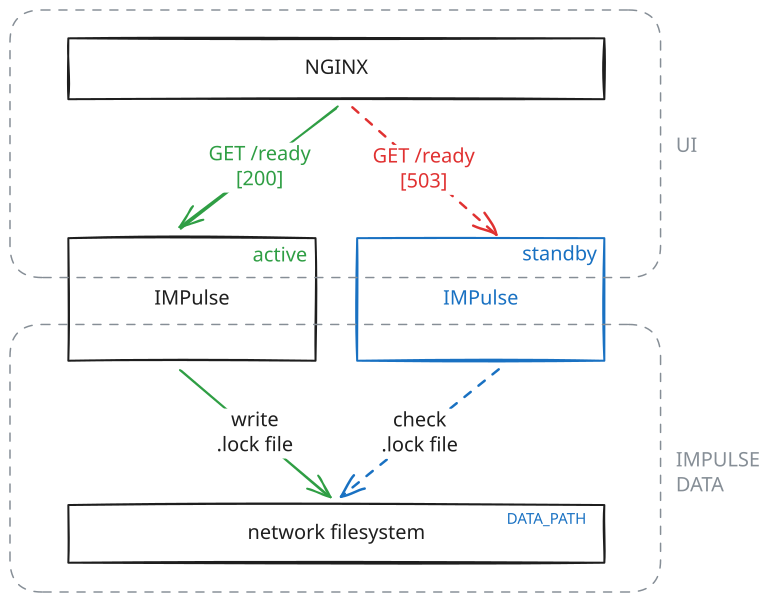

# High Availability

## Two instances

IMPulse allows running multiple instances to ensure high availability.

Instances sharing the same [storage](storage.md) elect one **primary**. Other instances start in **standby** mode and wait until the primary shuts down or its lock expires.

Check the `/readyz` endpoint to get the instance state. It responds with `200` if the instance is ready and **primary**, and `503` if the instance is in **standby**.

The `/livez` endpoint is used for liveness checks and always returns `200` if the container is alive, regardless of whether it's in **standby** or **primary** mode. This endpoint is available in both modes and should be used for Kubernetes liveness probes.

When running multiple IMPulse instances, configure your proxy (Nginx or another) to use the `/readyz` endpoint for readiness checks, routing traffic only to the **primary** instance. Use `/livez` for liveness checks to ensure containers are restarted if they become unresponsive. See [API](api.md) for endpoint details.

## Lock

The **primary** renews its lock every 6 seconds. A **standby** instance takes over when the lock is not renewed for 18 seconds, or immediately after the **primary** deletes it on graceful shutdown.

### Filesystem

With [filesystem](storage.md#filesystem) storage, expiry is checked against host clocks, so keep them synchronized; renewal failures do not demote the **primary**, see [Read-only filesystem](#read-only-filesystem).

### S3

With [s3](storage.md#s3) storage, the lock is the `.lock.d/lease.json` object at the bucket root. It is created, renewed, and deleted with conditional requests, so an old **primary** cannot overwrite or remove the new **primary**'s lock.

The endpoint must provide strong consistency and support conditional `PutObject` (`If-None-Match` and `If-Match`) and conditional `DeleteObject` (`If-Match`). Expiry uses S3 server time with one-second precision, so host clocks do not matter and takeover waits one extra second; a **primary** that cannot renew its lock stops processing and returns to **standby**, and no instance is promoted while S3 is unavailable.

## Read-only filesystem

When using `STORAGE_BACKEND=filesystem`, if the filesystem of the server where IMPulse is running becomes full, IMPulse will continue working. Data won't be lost as long as IMPulse continues running.

!!! danger "Danger"
    Do not stop or restart it

`ERROR` log messages about the issue will be produced.

This mechanism doesn't solve the problem, but protects from its consequences for some time.

To avoid such problems, configure monitoring for the server where IMPulse is running.
